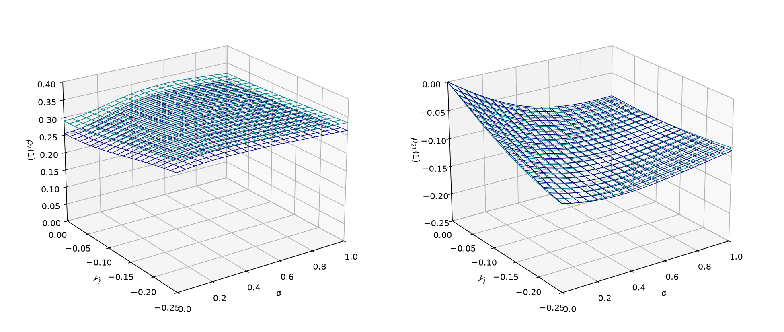
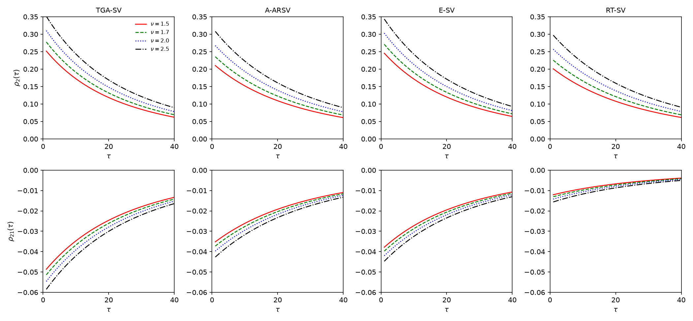
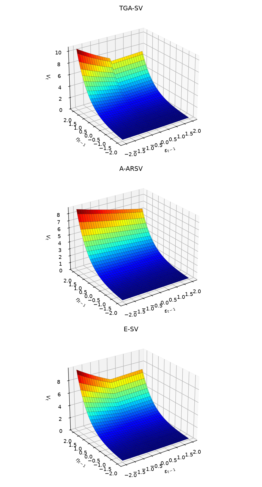

# ABC-filter ML for asymmetric SV models (SP500)
Reproduction of Mao, Czellar, Ruiz & Veiga (2016) + comparison with other estimation methods.

The main objective of the paper is to propose a model to the return volatility and a method to estimate their parameters. As the paper does, we are going to reproduce some results using the S&P 500 results.

## The problem, the method and the whys

The model assumes that volatility exists, but no one sees it. Volatility is like a measure of how nervous the market is: how much the prices fluctuate. What we get as data is just the return, a single number each day. A given return doesn't necessarily say much about the volatility, a high return, for example, can come from a high volatility or a rare draw with low volatility.
In SV models the volatility is a hidden variable that runs by itself and has its own noise. We can only infer it by the returns, just like we can only see the mood of someone by their actions. This is the main difference between SV and models like GARCH, where the volatility is exaclty determined by past returns.

We want the model to capture three main things (as observed in the S&P500 returns):
- Volatile days tend to be followed by volatile days (volatility persistence or clustering).
- Extreme price movements occur more frequently than expected under a normal distribution (fat tails).
- Price drops tend to be followed by higher volatility than price increases of the same magnitude (the leverage effect).

A model in which volatility is hidden, persistent over time and reacts to the previous day's return can reproduce these three facts. The price of this flexibility is that, since volatility is never observed, estimating the model is hard.

-------------------------------

## Basic structure of the project

```
.
├── README.md
├── requirements.txt
├── data
│   └── sp500.csv
├── experiments
│   ├── descriptive_statistics.py
│   └── theorical_properties.py
├── results
│   ├── images
│   │   ├── figure1_rho2_rho21_vs_alpha_gamma1.png
│   │   ├── figure2_theoretical_acf_ccf_by_nu.png
│   │   ├── figure3_volatility_response_surfaces.png
│   │   ├── figure5a_sp500_daily_returns.png
│   │   ├── figure5b_sample_acf_ccf_in_sample.png
│   │   └── figure5b_sample_vs_plugin_acf_ccf.png
│   └── tables
│       ├── figure5b_sample_acf_ccf_in_sample.csv
│       ├── table2_reproduced.csv
│       └── table2_sample_moments_sp500.csv
└── src
    ├── data_utils.py
    ├── download_data.py
    ├── __init__.py
    ├── stats_utils.py
    └── theory.py

```

-------------------------------

# Reproducing the Results
 
## Statistical Properties of GA-SV Models
 
### The basics and what makes GA-SV different
 
A classical Stochastic Volatility (SV) model assumes that financial returns have a time-varying, unobservable variance. The observed returns are modeled as
 
$$
y_t = \exp\left(\frac{h_t}{2}\right)\epsilon_t
$$
 
where:
 
- $y_t$: observed financial return.
- $h_t$: latent log-volatility (the log of the variance).
- $\epsilon_t \sim \mathcal{N}(0,1)$: observation noise.
The latent log-volatility evolves according to an autoregressive process
 
$$
h_t - \mu = \phi(h_{t-1} - \mu) + \eta_{t-1},
$$
 
where $\eta_t \sim \mathcal{N}(0,\sigma_\eta^2)$ is the volatility noise, independent of $\epsilon_t$.
 
This means volatility tends to persist over time: periods of high volatility tend to be followed by high volatility, while quiet periods tend to remain quiet.
 
The key difference of the GA-SV family is the additional function $f$, which introduces a dependence between past return shocks and future volatility:
 
$$
h_t - \mu = \phi(h_{t-1} - \mu) + f(\epsilon_{t-1};\theta) + \eta_{t-1}.
$$
 
Here:
 
- $\mu$ is the scale parameter, related to the marginal variance of the returns.
- $\phi$ controls volatility persistence.
- $f(\epsilon_{t-1};\theta)$ captures the impact of the past *standardized shock* $\epsilon_{t-1}$ (the return divided by its volatility) on current volatility, and has the same sign as the return.
- $\eta_t \sim \mathcal{N}(0,\sigma_\eta^2)$ is additional Gaussian noise, independent of $\epsilon_t$.
This allows the model to capture the leverage effect: negative returns tend to increase future volatility more than positive returns of the same magnitude.
 
A second difference is that, in the GA-SV family, $\epsilon_t$ does not need to be Gaussian: it can be any i.i.d. sequence with mean zero and variance one. The paper uses a standardized Generalized Error Distribution (GED), which allows for heavier tails than the Normal.
 
### How the leverage and the threshold change the correlations
 
The first thing the paper does is to show how the parameters of $f$ change two quantities that we can also measure in the data:
 
- $\rho_2(1) = \mathrm{Corr}(y_t^2, y_{t+1}^2)$: the first-order autocorrelation of squared returns (volatility clustering).
- $\rho_{21}(1) = \mathrm{Corr}(y_t, y_{t+1}^2)$: the first-order cross-correlation between the return today and the squared return tomorrow (leverage effect).
Figure 1 shows both for a Gaussian TGA-SV model ($\phi = 0.98$, $\sigma_\eta^2 = 0.05$) as a function of the threshold $\alpha$ and the leverage parameter $\gamma_1$, for $\gamma_2 = 0$ (dark blue) and $\gamma_2 = 0.1$ (green).
 

 
*Figure 1. First-order autocorrelation of squared returns $\rho_2(1)$ (left) and first-order cross-correlation $\rho_{21}(1)$ (right) as a function of $(\alpha,\gamma_1)$.*
 
What we see:
- $\rho_2(1)$ (left) is fairly flat in $(\alpha,\gamma_1)$ and gets larger with $\gamma_2$.
- $\rho_{21}(1)$ (right) does not depend on $\gamma_2$, changes almost linearly with $|\gamma_1|$, and shows a nonlinear effect from $\alpha$ that is clearest when $\gamma_1=0$.


### Nested models

The most general specification we consider is the **Threshold GA-SV (TGA-SV)**, in which the effect of the shock $\epsilon_t$ on next-day log-volatility is

$$
f(\epsilon_t;\theta) = \alpha\,\mathbb{1}(\epsilon_t<0) + \gamma_1\epsilon_t + \gamma_2\left(|\epsilon_t| - E|\epsilon_t|\right).
$$

Each term plays a different role:

- $\gamma_1\epsilon_t$ is the *classical leverage*: with $\gamma_1<0$ a negative shock raises future volatility and a positive one lowers it.
- $\alpha\,\mathbb{1}(\epsilon_t<0)$ is a *threshold*: negative shocks shift the volatility by a fixed amount, whatever their size.
- $\gamma_2(|\epsilon_t|-E|\epsilon_t|)$ is the *EGARCH term*: large shocks of either sign change volatility (the constant $E|\epsilon_t|$ is subtracted so the term has mean zero).

Setting some of these parameters to zero gives well-known models, all nested in the TGA-SV:

| Model | Restrictions | Idea |
|---|---|---|
| TGA-SV | none | leverage + threshold + EGARCH term |
| E-SV | $\alpha = 0$ | EGARCH plus an extra noise term |
| A-ARSV | $\alpha=\gamma_2=0$ | only classical leverage ($f=\gamma_1\epsilon_t$) |
| ARSV | $\alpha=\gamma_1=\gamma_2=0$ | symmetric SV, no leverage ($f=0$) |
| RT-SV | $\gamma_1=\gamma_2=0$ | only the threshold: constant shift when the shock is negative |

$\text{TGA-SV} \supset \text{E-SV} \supset \text{A-ARSV} \supset \text{ARSV}$, and $\text{RT-SV}$ is a different branch inside the $\text{TGA-SV}$.


The shock $\epsilon_t$ can be Gaussian (suffix **-N**) or follow a standardized GED($\nu$) (suffix **-G**), which gives heavier tails when $\nu<2$. The Gaussian is the case $\nu=2$, so every "-N" model is nested in its "-G" version. In the empirical application this gives the 8 models of Table 3, and the nesting allows likelihood-ratio tests against the TGA-SV-G.

#### What the nested models imply for the moments



*Figure 2. Theoretical ACF of squared returns (top) and CCF between returns and future squared returns (bottom) for TGA-SV, A-ARSV, E-SV and RT-SV, for different GED parameters $\nu$ ($\phi=0.98$, $\sigma_\eta^2=0.05$).*

Reading the figure:
- **Effect of $\nu$.** Within each panel, heavier tails (smaller $\nu$) give smaller autocorrelations of squared returns, but have almost no effect on the cross-correlations.
- **Effect of $f$.** Adding $\gamma_2$ (A-ARSV $\to$ E-SV) increases the autocorrelations of squares but leaves the cross-correlations almost unchanged, since $|\epsilon|$ is symmetric and does not depend on the sign of the return. Adding $\alpha$ (E-SV $\to$ TGA-SV) barely changes the autocorrelations but makes the cross-correlations more negative. The RT-SV, with only the threshold, has the weakest cross-correlations.
- **Identification.** The E-SV with $\nu=2$ and the A-ARSV with $\nu=2.5$ have almost the same ACF and CCF, but different kurtosis. When $\nu$ is free, the correlations alone cannot separate $\gamma_2$ and $\sigma_\eta^2$; the distribution of the returns also has to be used.

#### How past shocks move tomorrow's volatility

To see how the choice of $f$ matters for the dynamics, the paper plots the *volatility response surface*

$$
V_t = \exp\left((1-\phi)\mu\right)\sigma_y^{2\phi}\,\exp\left(f(\epsilon_{t-1};\theta) + \eta_{t-1}\right).
$$

It is obtained by taking the exponential of the log-volatility equation and evaluating the lagged volatility at its average level (the marginal variance of the returns, $\sigma_y^2$). So $V_t$ shows how the variance today changes with the two shocks of yesterday: the return shock $\epsilon_{t-1}$ and the volatility shock $\eta_{t-1}$. We set $\phi=0.98$, $\sigma_\eta^2=0.05$ and $\exp((1-\phi)\mu)\sigma_y^{2\phi}=1$. The shape of the surface does not depend on the distribution of $\epsilon_t$ (except through the constant $E|\epsilon_t|$), since it only depends on $f$ and $\eta_{t-1}$.



*Figure 3. Volatility response $V_t$ as a function of $(\epsilon_{t-1},\eta_{t-1})$ for TGA-SV with $(\alpha,\gamma_1,\gamma_2)=(0.07,-0.08,0.1)$ (top), A-ARSV with $(0,-0.08,0)$ (middle) and E-SV with $(0,-0.08,0.1)$ (bottom).*

What we see:
- **TGA-SV (top):** the surface *jumps* at $\epsilon_{t-1}=0$, because of the indicator in $f$. The variance is a factor $e^{\alpha}\approx 1.07$ higher just below zero than just above it.
- **A-ARSV (middle):** the surface is smooth, since $f=\gamma_1\epsilon_{t-1}$ is linear in the shock: a negative shock raises $V_t$ and a positive one lowers it, with no kink.
- **E-SV (bottom):** there is no jump, but a kink at $\epsilon_{t-1}=0$ because of $|\epsilon_{t-1}|$. With $\gamma_1=-0.08$ and $\gamma_2=0.1$ the log-response is steep for negative shocks (slope $-0.18$) and almost flat for positive ones (slope $0.02$).
- In all panels the effect of $\epsilon_{t-1}$ is larger when $\eta_{t-1}$ is positive. This is because $V_t = \exp(f)\exp(\eta)$: the shocks multiply each other, so the same change in $f$ is a larger change in $V_t$ when volatility is already high.
